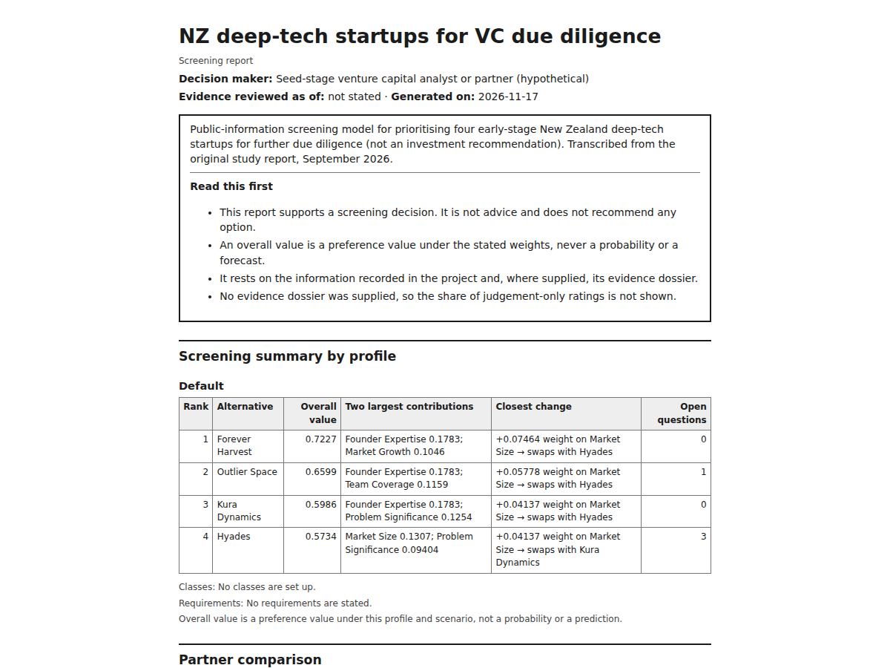
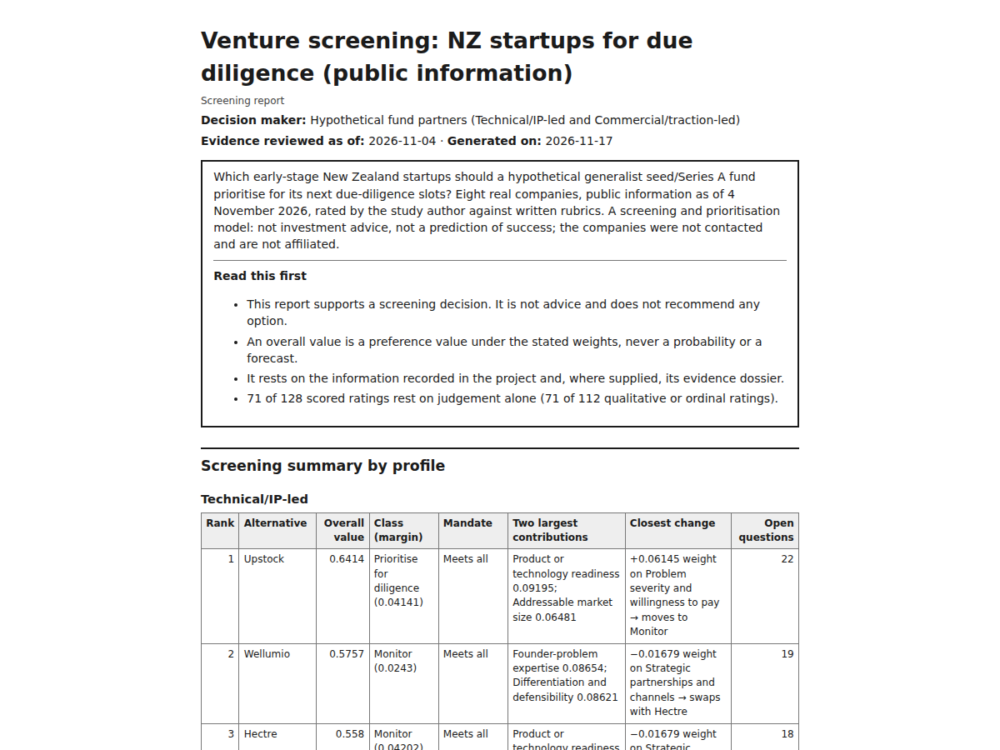
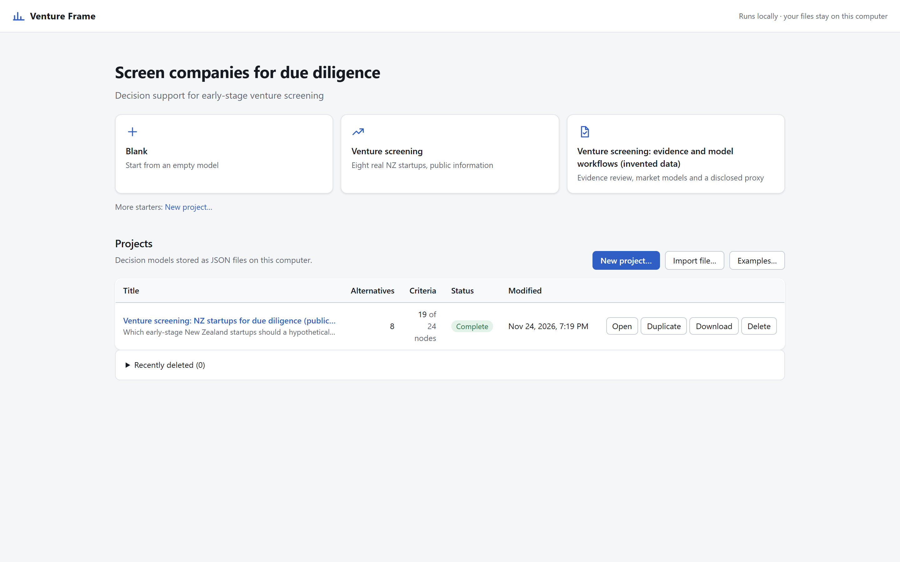
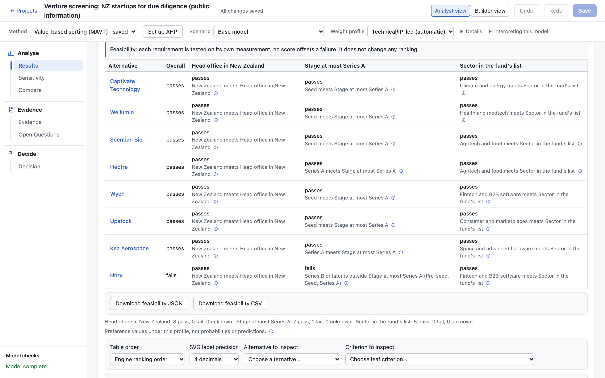
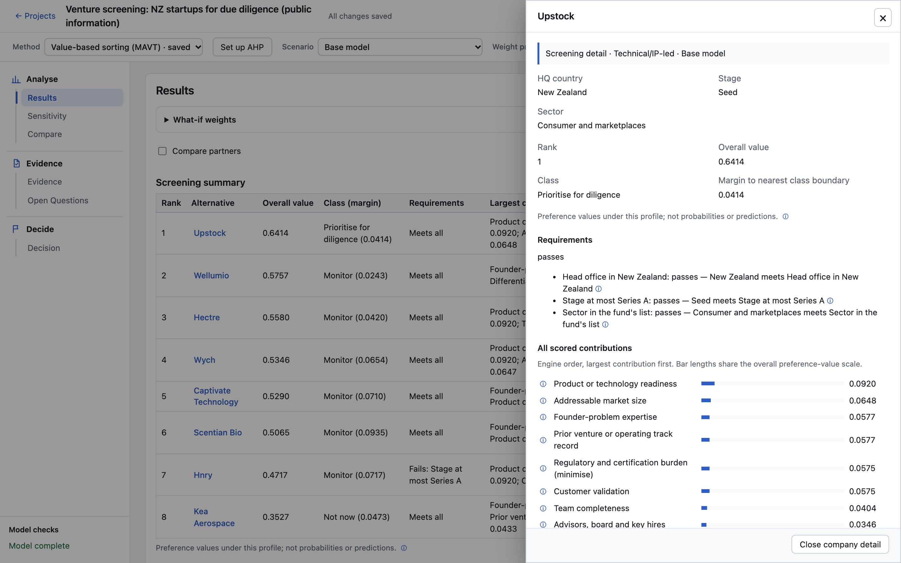
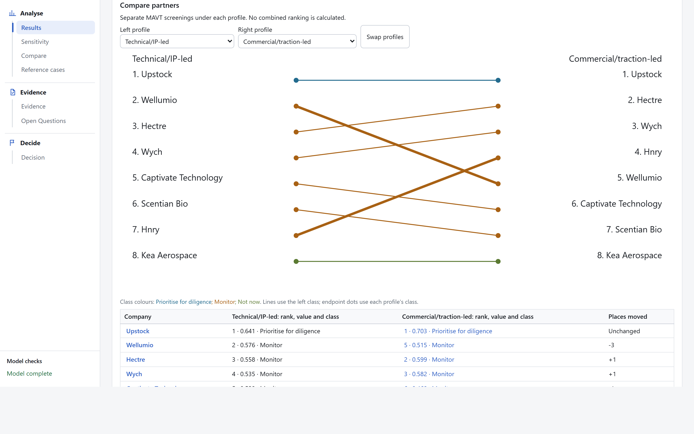
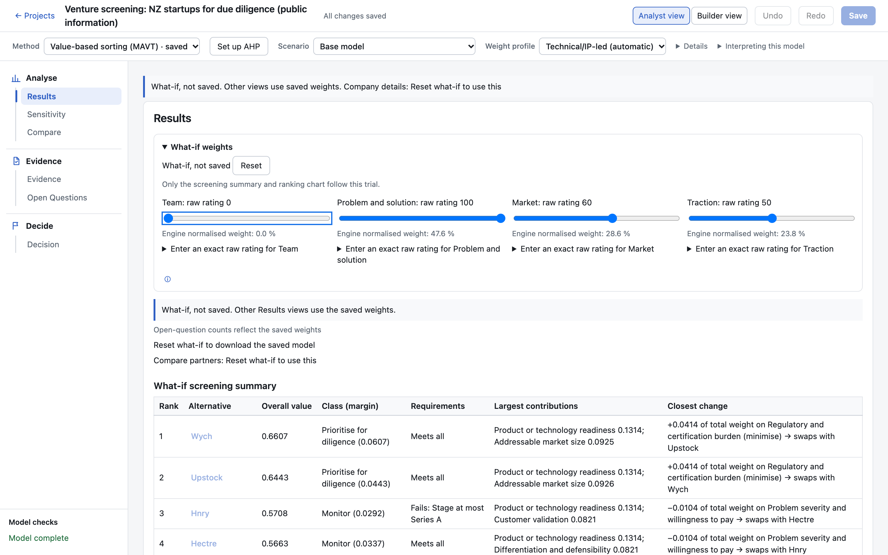
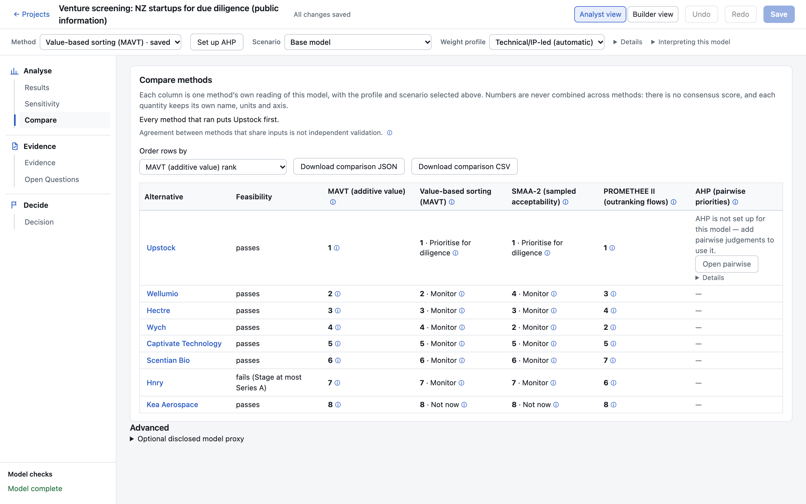
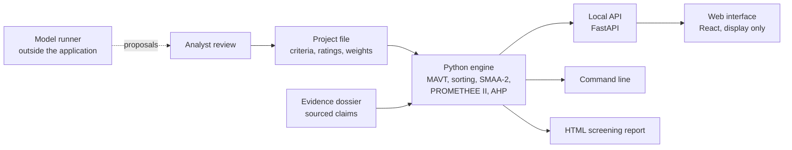

# Venture Frame

[](https://github.com/spar473/venture-frame/actions/workflows/ci.yml)
[](LICENSE)


**Decision support for early-stage venture screening.** Venture Frame helps an investment team
decide which companies deserve the next due-diligence slots. It shows each partner's reasoning,
the evidence behind every rating, and how close each call is.

> Venture Frame screens and prioritises. It does not recommend investments, predict success or
> produce probabilities.

[Case studies](#case-studies) · [Product tour](#product-tour) · [Getting started](#getting-started) ·
[Methodology](#methodology) · [Scope and limitations](#scope-and-limitations)


## Overview

A fund sees far more companies than it can diligence, and the choice of which to look at next is
usually made in conversation. Partners weigh criteria differently, some facts are disputed or out
of date, and it is rarely clear how close the decision was. Venture Frame turns that conversation
into an explicit, inspectable model:

| Capability | What it gives the team |
| --- | --- |
| **Mandate screening** | Stage, geography and sector requirements, shown beside the ranking. No score can offset a failure. |
| **Partner profiles** | Each partner's weighting produces its own ranking, side by side. Nothing is averaged. |
| **Prioritisation classes** | *Prioritise for diligence / Monitor / Not now*, with each company's margin to the next class. |
| **Decision sensitivity** | The exact weight change that would reorder two companies or move one across a class boundary. |
| **Sourced evidence** | Every rating is linked to a dated, cited claim. Disputed and outdated claims stay visible. |
| **Method cross-checks** | Sampled uncertainty analysis and a non-compensatory method, each reported separately. |
| **Shareable reports** | A single self-contained HTML file per screen, readable without installing anything. |

## Case studies

Four worked cases, from the study that started the project to the newest work. Each has a
one-page brief and the screening report generated by the engine.

### 1. The original deep-tech study



Four New Zealand deep-tech startups ranked for a hypothetical seed fund. This is the author's
September 2026 study, first carried out in DECERNS. Venture Frame was built to reproduce it from
scratch, and its numbers now serve as the engine's main regression test.

[Brief](cases/1-original-deep-tech-study/README.md) ·
[Screening report](https://spar473.github.io/venture-frame/cases/1-original-deep-tech-study/screening-report.html)

<br clear="right">

### 2. Venture screening



Eight real NZ startups across six sectors, rated from public information as of 4 November 2026
for a hypothetical seed/Series A fund. It has a mandate check, two partner weightings, three
classes and 154 sourced claims, and it is the case the [product tour](#product-tour) walks through.

[Brief](cases/2-venture-screening/README.md) ·
[Screening report](https://spar473.github.io/venture-frame/cases/2-venture-screening/screening-report.html) ·
[Six-minute walkthrough](docs/vc-demo-walkthrough.md)

<br clear="right">

### 3. First-round retrospective


Five NZ companies rated as they stood around their first funding rounds, using only sources from
that window, then set beside what happened next. It is a look-back showcase with draft ratings,
not a validation study.

[Brief](cases/3-first-round-retrospective/README.md) ·
[Screening report](https://spar473.github.io/venture-frame/cases/3-first-round-retrospective/screening-report.html)

<br clear="right">

### 4. Model suggestions, reviewed by a person

How a classifier can propose ratings from source text without ever deciding them. Every
suggestion is accepted, corrected or rejected by an analyst, and confidence never becomes a
weight. The worked example uses invented data.

[Brief](cases/4-model-proposals-reviewed/README.md)

The companies in cases 1–3 are real and named from public information only. They were not
contacted and are not affiliated; nothing here is investment advice or a statement about any
company beyond what its cited source says.

## Product tour

The screening workflow, in the order an analyst uses it, on case 2:

| | |
| --- | --- |
|  |  |
| **1 · Open a case.** Start from a worked example or a blank project. Then read the screening summary (shown at the top of this page). | **2 · Check the mandate.** A company outside the fund's mandate is flagged beside its rank, never hidden. |
|  |  |
| **3 · Inspect a company.** Every scored contribution, the closest change, and the rubric level and source behind each rating. | **4 · Compare partners.** Two weightings side by side, and the places each company moves between them. |
|  |  |
| **5 · Test sensitivity.** The exact weight at which the ranking or a class changes, and who swaps. | **6 · Try a what-if.** A temporary, unsaved reweighting. Reset returns to the saved reading. |
|  | |
| **7 · Cross-check methods.** Each method's reading side by side, with its own reasons. There is no blended score. | |

## Getting started

**Prerequisites:** Python 3.12 and Node.js 20.19 or later, on macOS or Linux. On Windows, use WSL2:
the project library's file lock is POSIX-only.

```sh
git clone https://github.com/spar473/venture-frame.git
cd venture-frame
python3.12 -m venv .venv
.venv/bin/python -m pip install --require-hashes -r requirements/build-py312.txt -r requirements/dev-py312.txt
.venv/bin/python -m pip install --no-deps --no-build-isolation -e '.[dev]'
npm --prefix frontend ci
npm --prefix frontend run build
.venv/bin/mcda serve --open
```

The application opens at <http://127.0.0.1:8765>. Select **Venture screening** on the start page
to open case 2. The server listens on the local machine only and has no authentication. The
[user guide](docs/user-guide.md) covers every screen.

The same engine is available from the command line (with `.venv/bin` on your `PATH`):

```sh
mcda evaluate examples/nz_venture_screening/project.json             # ranking and contributions
mcda sensitivity examples/nz_venture_screening/project.json --all    # exact crossovers
mcda compare-methods examples/nz_venture_screening/project.json      # every method side by side
mcda report screening examples/nz_venture_screening/project.json \
  --evidence examples/nz_venture_screening/evidence.json -o report.html
```

## Methodology

A screen is defined by its criteria (for example team, problem, market and traction), a value
scale for each criterion with a written rubric, and each partner's swing weights. The engine then
applies several established multi-criteria decision analysis methods. Each method is reported on
its own terms; no consensus score is formed.

| Method | Question it answers |
| --- | --- |
| Multi-attribute value theory (MAVT) with swing weighting | How do the companies rank under each partner's stated preferences? |
| Value-based sorting | Which class does each company fall in, and how far is it from the boundary? |
| One-way sensitivity | At exactly what weight does the ranking or a class change? |
| SMAA-2 | How often does each company take each rank when ratings and weights vary within stated ranges? |
| PROMETHEE II | Does the order hold when strong criteria cannot simply compensate for weak ones? |
| AHP | What do pairwise judgements imply, as an alternative way of eliciting priorities? |

Values lie in [0, 1] and express preference under stated weights. They are not probabilities,
forecasts or expected returns. The [mathematical specification](docs/mathematics/specification.md)
gives every formula, and [method limitations](docs/mathematics/method-limitations.md) explains
when each method misleads.

## Architecture



- **One source of numbers.** All calculation happens in the Python engine. The interface only
  displays results.
- **Judgements are stored, results are derived.** Viewing a profile or method never changes the
  saved project.
- **Offline by design.** The application never calls a model or an external service. Model output
  enters only as proposals that a person reviews, and the model never sees the analyst's ratings.
- **Domain-neutral engine.** Venture content lives entirely in the example data. This is why
  `examples/` also contains non-venture projects used by the test suite.

## Verification

On 17 November 2026 the full local test run on this repository passed:

- 2,364 Python tests, 573 frontend unit tests and 134 browser tests;
- Ruff, strict mypy and the production build;
- byte-identical checks on 969 historical numerical and export outputs, matching the manifest
  recorded on macOS and Linux on 16 November 2026;
- byte-identical wheels from two build routes, and an installed smoke test.

Each method is checked against an independent oracle written without the engine, including
published PROMETHEE II and AHP examples reproduced in exact fractions. See
[testing](docs/development/testing.md) for the commands.

## Scope and limitations

- **Prototype status.** Built and tested by one author. No external user study has been run yet.
- **Public information only.** Ratings rest on what was publicly visible at the stated dates, so
  a company with little public presence scores lower than an equally strong one with more
  coverage.
- **No outcome validation.** Case 3 sets five first rounds beside what happened next, but five
  selected cases cannot establish predictive value.
- **No model accuracy claims.** Model suggestions are proposals only. A second, blind human rating
  of case 2 is required before any model can be scored, and it has not yet been made.

Further limits are listed in [known limitations](docs/development/known-limitations.md).

## Documentation

| Topic | Location |
| --- | --- |
| Using the application | [User guide](docs/user-guide.md) |
| Case studies | [cases/](cases/README.md) |
| Mathematics | [Specification](docs/mathematics/specification.md) · [Method limitations](docs/mathematics/method-limitations.md) |
| Architecture and file format | [Overview](docs/architecture/overview.md) · [Project schema](docs/architecture/project-schema.md) |
| HTTP API | [API contract](docs/api/contract.md) · [OpenAPI](docs/api/openapi.json) |
| Feature specifications | [Design notes](docs/design/) |
| Testing | [Testing](docs/development/testing.md) |

The engine is packaged as `mcda_studio` with the command `mcda`.

## Origin

Venture Frame grew out of the author's study *Prioritising New Zealand Deep-Tech Startups for
Venture Capital Due Diligence* (September 2026), carried out in DECERNS (case 1). The report is
not distributed here; [its citation and a summary](docs/reference/original-study/) are. The
project is not affiliated with, endorsed by or derived from DECERNS, and contains no DECERNS code,
assets or file formats. [ACKNOWLEDGEMENTS.md](ACKNOWLEDGEMENTS.md) credits data sources,
open-source dependencies and AI assistance.

## Feedback

Feedback from investors and analysts is especially welcome: what a screen like this gets wrong in
practice, what is missing, and what you would remove. Please open an issue.

## Licence

Released under the [MIT licence](LICENSE). Third-party names and software keep their own terms.
