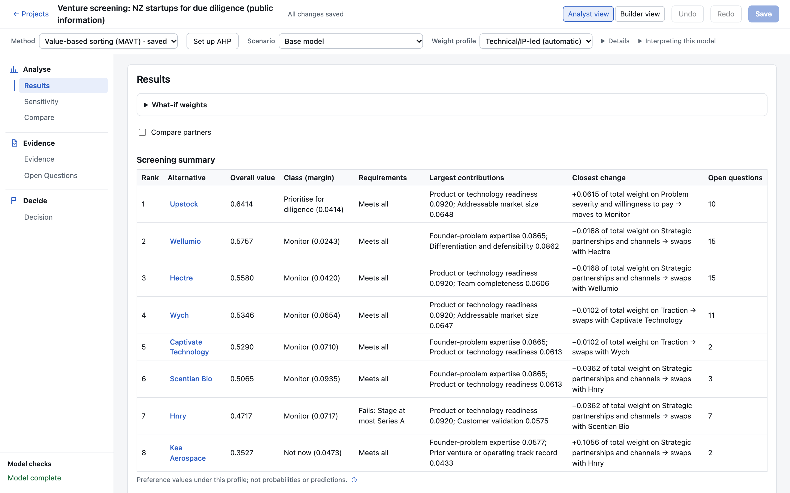
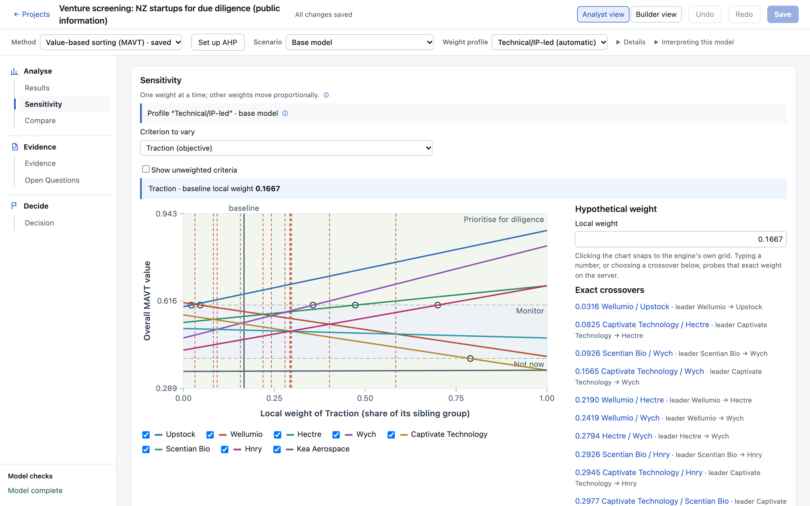

# Venture Frame

**A local workbench for screening early-stage companies and deciding which ones deserve the next
due-diligence slots, with the reasons, the evidence and the open questions in view.**

A fund sees far more companies than it can diligence. The choice of which to look at next is
usually a conversation: partners weigh things differently, some facts are disputed or out of date,
and nobody can say how close the call was. Venture Frame makes that judgement explicit and
arguable:

- a **mandate check** (stage, geography, sector) that no score can offset;
- **two partners' weightings side by side**, each with its own ranking, never averaged;
- classes such as **Prioritise for diligence / Monitor / Not now**;
- **how close each company is to changing place**: the exact weight change that would move it;
- every rating backed by a **sourced claim**, with disputed and outdated claims left open;
- a one-file **screening report** a partner can read without installing anything.

It screens and prioritises. **It does not recommend investments or predict success**, and no
score is a probability.



## Four case studies

Each case has a one-page brief and the screening report the engine produced for it. The reports
are single HTML files with no scripts; GitHub shows HTML as source, so open them from the links
below or download and open them in a browser.

| Case | The question | Brief | Report |
| --- | --- | --- | --- |
| **1. Venture screening** | Which of eight real NZ startups, across six sectors, should a hypothetical seed/Series A fund diligence next? | [Brief](cases/1-venture-screening/README.md) | [Report](https://spar473.github.io/venture-frame/cases/1-venture-screening/screening-report.html) |
| **2. First-round retrospective** | How would five NZ companies have screened at their first rounds, set beside what actually happened? | [Brief](cases/2-first-round-retrospective/README.md) | [Report](https://spar473.github.io/venture-frame/cases/2-first-round-retrospective/screening-report.html) |
| **3. The original deep-tech study** | Which of four NZ deep-tech startups should a seed fund diligence first? The study this project grew from | [Brief](cases/3-original-deep-tech-study/README.md) | [Report](https://spar473.github.io/venture-frame/cases/3-original-deep-tech-study/screening-report.html) |
| **4. Model suggestions, reviewed by a person** | How can a classifier suggest ratings without ever deciding them? | [Brief](cases/4-model-proposals-reviewed/README.md) | (walkthrough in the brief) |

The companies in cases 1–3 are real and named from public information only. They were not
contacted and are not affiliated; nothing here is investment advice or a statement about any
company beyond what its cited source says.

## A quick look

| | |
| --- | --- |
|  |  |
| **Company detail.** Every scored contribution, the closest change and the rubric level and source behind each rating. | **Compare partners.** Two weightings side by side, each its own reading; nothing is averaged. |
|  |  |
| **Mandate.** A failure sits beside the ranking; no score offsets it. | **Sensitivity.** The exact weight at which the ranking or class changes, and who swaps. |

The [six-minute walkthrough](docs/vc-demo-walkthrough.md) is a click path through case 1.

## What is honest to say about it

- **A working prototype by one author.** Every number comes from a tested Python engine, but no
  outside user has tried it yet.
- **Public information only, as of stated dates.** A quiet company scores lower than a loud one
  with the same substance; the briefs say where that matters.
- **Not validated against outcomes.** Case 2 sets five first rounds beside what happened next, but
  five hand-picked cases cannot show predictive value.
- **No model accuracy is claimed.** Model suggestions are only proposals a person accepts or
  rejects. A second person has not yet rated the case 1 companies blind, so there is no human
  reference to score a model against.

## How it works, briefly

You state the criteria (for example team, problem, market, traction), what each level of each
criterion is worth, and how much each partner cares about each criterion, using swing weights.
The engine then gives:

- a ranking under each partner's weights (additive multi-attribute value theory, MAVT);
- classes from fixed value boundaries;
- the exact weight change that would reorder companies or move one across a class boundary;
- a sampled check under stated uncertainty (SMAA-2);
- a non-compensatory cross-check in which strong criteria cannot simply offset weak ones
  (PROMETHEE II).

Each method's reading is shown side by side with its own reasons; there is no blended score.
Everything runs on your own machine, and the application never calls a model.

## Run it yourself

Python 3.12 and Node 20.19+, on macOS or Linux (on Windows, use WSL2):

```sh
git clone https://github.com/spar473/venture-frame.git
cd venture-frame
python3.12 -m venv .venv
.venv/bin/python -m pip install --require-hashes -r requirements/build-py312.txt -r requirements/dev-py312.txt
.venv/bin/python -m pip install --no-deps --no-build-isolation -e '.[dev]'
npm --prefix frontend ci
npm --prefix frontend run build
.venv/bin/mcda serve --open
```

The app opens at <http://127.0.0.1:8765>. On the start page, open **Venture screening** for
case 1. The server binds to your machine only and has no authentication; do not expose it on a
network. The [user guide](docs/user-guide.md) covers every screen.

## For engineers

The engine is called MCDA Studio (package `mcda_studio`, command `mcda`). Python is the only
source of numbers; the React interface only displays them. Venture content lives entirely in
the example data: the engine itself is domain-neutral, which is why `examples/` also holds a
few non-venture projects that its tests use.

| Topic | Where |
| --- | --- |
| Using the app | [User guide](docs/user-guide.md) |
| Mathematics | [Specification](docs/mathematics/specification.md) · [Method limitations](docs/mathematics/method-limitations.md) |
| Architecture and file format | [Overview](docs/architecture/overview.md) · [Project schema](docs/architecture/project-schema.md) |
| HTTP API | [API contract](docs/api/contract.md) · [OpenAPI](docs/api/openapi.json) |
| Rules behind each feature | [Design notes](docs/design/) |
| Tests and limits | [Testing](docs/development/testing.md) · [Known limitations](docs/development/known-limitations.md) |

On 17 November 2026 the full local gate on this tree passed 2,364 Python, 573 frontend and
134 browser tests, Ruff, strict mypy and the production build, and kept all 969 historical
numerical and export outputs byte-identical.

## Background

Venture Frame grew out of the author's study *Prioritising New Zealand Deep-Tech Startups for
Venture Capital Due Diligence* (September 2026), carried out in DECERNS (case 3). The report is
not distributed here; [its citation and a summary](docs/reference/original-study/) are. The
project is **not affiliated with, endorsed by or derived from DECERNS** and contains no DECERNS
code, assets or file formats. [ACKNOWLEDGEMENTS.md](ACKNOWLEDGEMENTS.md) credits data sources,
open-source dependencies and AI assistance.

Feedback is welcome, especially on what a screen like this gets wrong in practice and what you
would cut.

## Licence

Code and documentation are released under the [MIT licence](LICENSE). Third-party names and
software keep their own terms.
