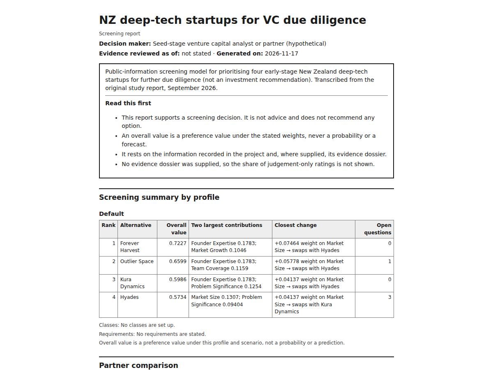

# Case 1: The original deep-tech study

**The question.** Which of four early-stage New Zealand deep-tech startups (Hyades, Forever
Harvest, Kura Dynamics and Outlier Space) should a hypothetical seed fund prioritise for further
due diligence?

**Open:** [the screening report](https://spar473.github.io/venture-frame/cases/1-original-deep-tech-study/screening-report.html)
([file](screening-report.html)) · [the full study](../../examples/nz_deeptech_vc/README.md) ·
[the original report's citation and summary](../../docs/reference/original-study/).

> Real companies, public and partly promotional sources, and the author's own judgements made in
> September 2026. Not investment advice and not a statement about any company's quality or
> prospects. The companies did not take part.

## Where this project started

This is the author's September 2026 study, first carried out in the decision-analysis software
DECERNS. Venture Frame was built to reproduce it from scratch and then go further. The model is
transcribed from the report: four objectives (Team, Problem & Solution, Market, Traction), eight
criteria, a concave value function for market size and swing weights. Its numbers match the
report's, and it is the engine's main regression test.

## Results

| Company | Overall value | Two largest contributions |
| --- | --- | --- |
| Forever Harvest | 0.7227 | Founder expertise, market growth |
| Outlier Space | 0.6599 | Founder expertise, team coverage |
| Kura Dynamics | 0.5986 | Founder expertise, problem significance |
| Hyades | 0.5734 | Market size, problem significance |

- **The order depends on how market size is valued.** With a linear instead of a concave market-size
  function, Kura Dynamics and Hyades swap third and fourth.
- **What it takes to change the leader.** Raising Team's local weight to 0.569 makes Outlier
  Space first; raising Market's to 0.674 makes Hyades first.
- **The study had no mandate, classes or evidence dossier.** Comparing this report with case 2's
  shows what those additions bring: requirements beside the ranking, classes with margins, and a
  sourced claim behind every rating.

## Limits

- Four companies, one rater, and public information as of September 2026.
- A rating such as "low customer validation" means only that little was publicly visible then.
