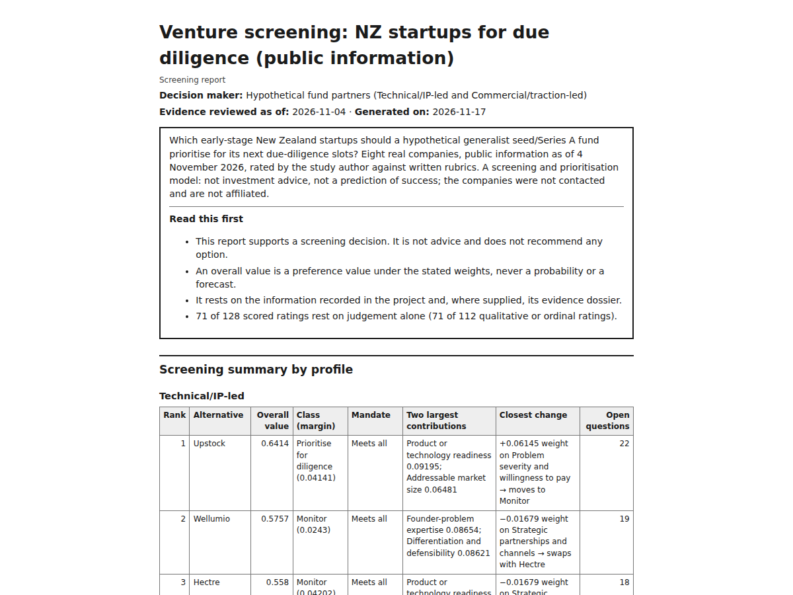

# Case 1: Venture screening

**The question.** Which early-stage New Zealand startups should a hypothetical generalist
seed/Series A fund prioritise for its next due-diligence slots?

**Open:** [the screening report](https://spar473.github.io/venture-frame/cases/1-venture-screening/screening-report.html)
([file](screening-report.html)) · [the full study](../../examples/nz_venture_screening/README.md) ·
in the app, **Venture screening** on the start page.

> Eight real companies, public information read on 4 November 2026, rated by the study author
> against written rubrics. Not investment advice, not a valuation and not a prediction of success.
> The companies were not contacted and are not affiliated.

## The companies

| Company | Sector | Stage |
| --- | --- | --- |
| Captivate Technology | Climate and energy | Seed |
| Wellumio | Health and medtech | Seed |
| Scentian Bio | Agritech and food | Seed |
| Hectre | Agritech and food | Series A |
| Wych | Fintech and B2B software | Seed (judgement) |
| Upstock | Consumer and marketplaces | Seed (judgement) |
| Kea Aerospace | Space and advanced hardware | Series A (judgement) |
| Hnry | Fintech and B2B software | Series B or later |

## The model

- **Mandate, screened and not scored:** head office in New Zealand, stage at most Series A, and a
  sector on the fund's list. A failure is shown beside the ranking; no score offsets it.
- **Sixteen scored criteria in four groups** (team, problem and solution, market, traction), each
  with a written rubric. Market size and growth are the median of named third-party publishers'
  estimates.
- **Two partners:** a Technical/IP-led and a Commercial/traction-led weighting, shown side by side.
- **Classes fixed before any rating:** Prioritise for diligence (value ≥ 0.60), Monitor (≥ 0.40),
  Not now.
- **Evidence:** 154 sourced claims. Two disputed claims are left open, and 33 sources older than
  12 months are marked outdated.

## What the screen shows

- **Upstock leads under both partners** and is the only company in *Prioritise for diligence*
  (0.6414 under the Technical/IP-led weighting). All of its sources are more than a year old, so
  a diligence team would refresh its evidence first.
- **The middle of the queue is close.** Neighbours swap places for 0.01–0.04 of the total weight.
- **Partners disagree.** Under the Commercial/traction-led weighting, Hectre rises to second and
  sits less than 0.001 below the *Prioritise* boundary.
- **Hnry fails the mandate** (Series C against a seed/Series A mandate). It keeps its place in
  every ranking, with the failure beside it.
- **Kea Aerospace** is in *Not now*; everyone else is in *Monitor*.
- **71 of the 128 scored ratings rest on judgement alone.** The report shows which ones.
- **The cross-checks agree on the leader.** PROMETHEE II also puts Upstock first. SMAA-2 ranks it
  first in most draws of the stated uncertainty and in every draw across the two partners'
  weights. These are preference values under stated assumptions, not probabilities of success.

## Limits

- Public, mostly company-published information; a quiet company scores lower than a loud one with
  the same substance.
- Not checked against what later happened to these companies.
- One person rated every cell. A blind rating kit for a second person exists, but no second rating
  has been made yet.

The [six-minute walkthrough](../../docs/vc-demo-walkthrough.md) is a click path through this case
in the app.
