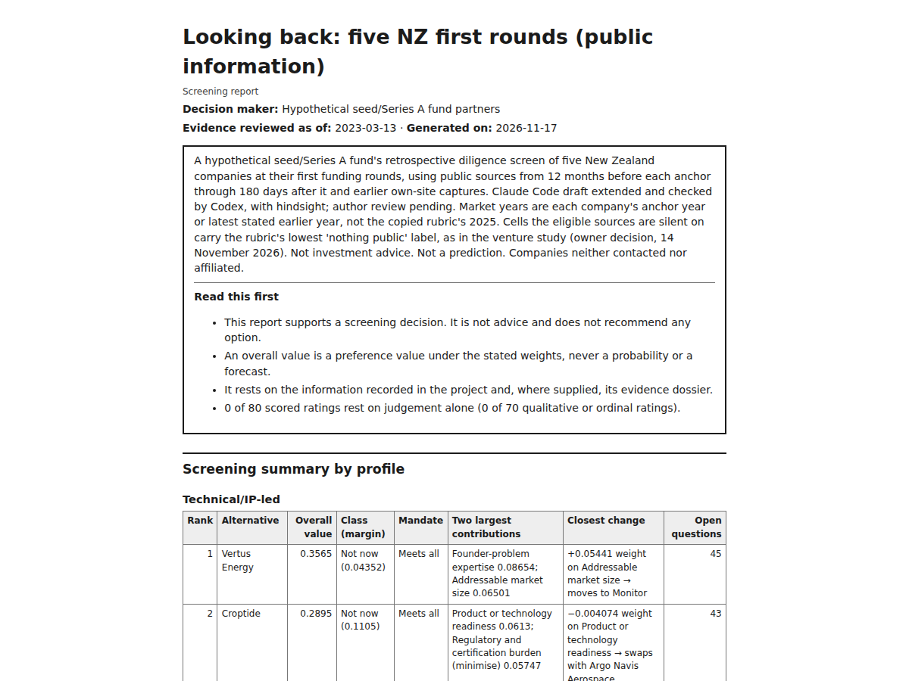

# Case 3: First-round retrospective

**The question.** How would five New Zealand companies have screened as they stood around their
first funding rounds, using only what was public then, and how does that compare with what
happened next?

**Open:** [the screening report](https://spar473.github.io/venture-frame/cases/3-first-round-retrospective/screening-report.html)
([file](screening-report.html)) · [the full study](../../examples/nz_first_round_retrospective/README.md).

> A look-back showcase, **not a validation study**: five hand-picked companies cannot show whether
> a method predicts anything. Not investment advice. The companies were not contacted and are not
> affiliated. Outcomes are dated public facts and say nothing about the people involved.

## How it was built

- **Same rubrics, same two partner weightings** as case 2, copied word for word.
- **Point-in-time sources.** Each company is anchored on its first round. Sources count only if
  published or captured from 12 months before the anchor to 180 days after it, plus earlier
  captures of the company's own website.
- **Outcomes are shown, never used.** No outcome enters the project, the evidence or the ratings.
- **Draft ratings, made with hindsight.** AI coding assistants drafted and checked the ratings
  while knowing each outcome. Every rating is marked *draft; author review pending*, and source
  dates cannot remove hindsight bias.
- **Read one report line with care.** The report says "0 of 80 scored ratings rest on judgement
  alone" because it counts only reviewed claims, and all 95 claims here are unreviewed drafts (the
  report lists them as "Not yet reviewed: 95"). In fact every claim is a judgement against the
  rubric, and 39 cells rest on the absence rule below or a sector judgement.
- **Thin records score low.** Where in-window sources say nothing, a cell gets the rubric's lowest
  "nothing public" label. This biases against companies that later closed, because they tend to
  leave fewer public traces.

## Results beside what happened next

| Company | Technical/IP-led | Commercial/traction-led | What happened next (as of) |
| --- | --- | --- | --- |
| Vertus Energy | 1 (0.3565) | 1 (0.2816) | Larger follow-on round raised (2024-06-27) |
| Croptide | 2 (0.2895) | 2 (0.2289) | Larger follow-on round raised (2023-12-13) |
| Argo Navis Aerospace | 3 (0.2871) | 3 (0.2273) | Liquidator appointed (2023-12-05) |
| RosterLab | 4 (0.2328) | 4 (0.1652) | Larger follow-on round raised (2024-11-27) |
| Helico | 5 (0.1921) | 5 (0.1518) | Liquidator appointed (2025-12-19) |

Every company falls in *Not now*. The classes were set for a fund's current pipeline, and these are
first-round snapshots with thin public records. Several ranks are fragile: Croptide and Argo Navis
swap places for a weight change of 0.004. The full study links every outcome to its public source.

## Limits

- Five selected companies, not a representative sample.
- Market segments are broad for three companies; two have only one publisher's estimate.
- Argo Navis's stage uses one stated exception to the source window.
